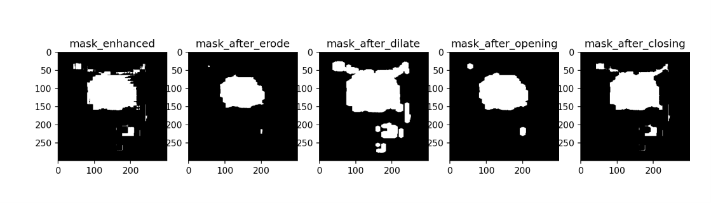

# 농구공 영역 및 외곽선 검출

`hw2.py`는 농구공 이미지의 색상과 밝기를 이용해 농구공 영역을 찾고, 검출한 영역과 외곽선을 초록색으로 표시하는 Python 프로그램입니다.

## 실행 환경 및 의존성

- Python 3
- OpenCV 4 (`opencv-python`): 이미지 읽기, 색공간 변환, 마스크 및 외곽선 처리
- NumPy (`numpy`): 이미지 배열 및 마스크 생성
- Matplotlib (`matplotlib`): 결과 이미지 표시
- scikit-image (`scikit-image`): 현재 코드에서 `skimage.data`를 import하므로 설치 필요. 실제 처리에는 사용하지 않습니다.

필요한 패키지는 다음 명령으로 설치할 수 있습니다.

```bash
python -m pip install opencv-python numpy matplotlib scikit-image
```

특정 패키지 버전 조합에서의 실행 검증은 별도로 수행하지 않았습니다.

## 파일 구성

```text
Vision-LLM-202235140/
├── 20261017/
│   ├── hw2.py
│   └── README.md
└── src/
    └── images/
        └── basketball_crop.jpg
```

## 실행 방법

저장소 최상위 폴더에서 다음 명령으로 실행할 수 있습니다.

```bash
cd 20261017
python hw2.py
```

이미지 경로 `../src/images/basketball_crop.jpg`는 터미널의 현재 폴더를 기준으로 해석됩니다. 따라서 실행 위치는 `20261017` 폴더여야 합니다. 별도의 명령행 인자는 없습니다.

## 처리 과정 및 실행 결과

1. 입력 이미지를 읽고 LAB 색공간으로 변환합니다. LAB는 밝기와 색 정보를 나누어 표현하는 방식입니다.
2. 밝기를 나타내는 L 채널에 CLAHE를 적용합니다. CLAHE는 이미지를 작은 구역으로 나누어 각 구역의 밝기 차이를 조절하는 방법입니다. 설정값은 `clipLimit=3.0`, `tileGridSize=(8, 8)`입니다.
3. 보정된 이미지에서 LAB 하한 `[70, 130, 70]`, 상한 `[180, 230, 185]`에 해당하는 픽셀을 골라 흑백 마스크를 만듭니다. 마스크는 선택한 부분을 흰색, 나머지를 검은색으로 표시한 이미지입니다.
4. 5×5 타원형 커널로 opening을 적용해 작은 잡음을 줄입니다. 커널은 주변 픽셀을 살펴보는 작은 틀이며, opening은 흰색 영역을 줄였다가 다시 넓히는 처리입니다.
5. 마스크의 바깥쪽 외곽선을 검출하고, 면적이 가장 큰 외곽선을 농구공 영역으로 선택합니다.
6. 선택한 영역에 초록색을 더해 표시하고, 두께 2픽셀의 초록색 외곽선을 그립니다.

결과는 Matplotlib 창에 표시됩니다. 결과 이미지를 파일로 저장하는 기능은 포함되어 있지 않습니다.

## 참고 사항

### Topology 선택 이유
- 침식, 팽창, opening, closing을 iterations = 3으로 설정한 결과이다.

- 아래 결과를 보면 opening에서 가장 결과가 좋다.



- 입력 이미지가 없거나 실행 위치가 다르면 이미지를 읽지 못해 색공간 변환 단계에서 오류가 발생할 수 있습니다.
- 결과 창을 표시하려면 그래픽 화면을 사용할 수 있는 실행 환경이 필요합니다.
- 색상 범위가 고정되어 있으므로 조명이나 입력 이미지가 바뀌면 검출 결과가 달라질 수 있습니다. 가장 큰 영역을 선택하므로 다른 물체가 더 크게 검출되면 해당 물체가 선택될 수 있습니다.
- 외곽선이 검출되지 않으면 영역 표시 없이 원본을 출력합니다. 현재 코드는 이 경우 BGR에서 RGB로 변환하지 않아 화면에서 색이 다르게 보일 수 있습니다.
- `hw2.py`만 제출하면 입력 이미지가 포함되지 않으므로, 재현을 위해 위 파일 구조와 입력 이미지가 함께 필요합니다.
